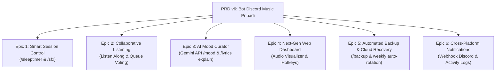

# Plan: Perancangan dan Penyusunan PRD v6 (Bot Discord Music Pribadi)

- **Tanggal**: 2026-10-18
- **Status**: Selesai (Implemented & Verified)
- **Author**: Antigravity (web-implementation)

---

## 1. Tujuan

Menyusun dokumen spesifikasi kebutuhan produk resmi **PRD v6 (Bot Discord Music Pribadi: Kolaborasi Real-Time, Personalisasi Imersif, dan Keandalan Tingkat Lanjut)** sebagai kelanjutan strategis dari PRD v1 sampai v5. 

Rencana ini menetapkan batasan arsitektur, tema inovasi, rincian epic fungsional, dan peta jalan implementasi agar bot musik pribadi ini tetap ringan, cepat, mandiri (self-hosted), namun memiliki pengalaman interaksi modern setara bot musik komersial kelas atas.

---

## 2. Asumsi & Pertanyaan Terbuka

### Asumsi:
1. **Infrastruktur & Batasan**: Bot tetap beroperasi secara mandiri di Windows (lokal/self-hosted) dengan batas desain PRD v3 (maksimal 5 server privat, 20 pengguna tepercaya, dan 3 sesi bersamaan).
2. **Stack Utama**: Node.js + TypeScript, discord.js v14, Lavalink v4 (Java 21), dan SQLite (WAL mode) tetap menjadi fondasi utama tanpa penulisan ulang arsitektur (zero rewrite).
3. **Kerahasiaan & Kunci API**: Setiap fitur eksternal (seperti Google Gemini API untuk pembuatan playlist berbasis mood) bersifat opsional, menggunakan `.env` untuk API Key, dan memiliki *graceful fallback* jika kunci tidak dikonfigurasi.
4. **Keamanan & Resource RAM**: Penambahan fitur baru tidak boleh meningkatkan konsumsi RAM bot melebihi 250MB dan tidak menambah beban CPU signifikan pada PC lokal pengguna.

### Pertanyaan Terbuka:
- *(Semua detail kebutuhan utama telah diselaraskan dengan arsitektur v1-v5; tidak ada pemblokir kritis)*.

---

## 3. Pendekatan Desain & Arsitektur

Untuk transisi ke PRD v6, dievaluasi dua pendekatan desain arsitektur:

### Opsi A (Rekomendasi): Modular Incremental Enhancement + Local Web Polish
- **Deskripsi**: Menjaga monolith modular yang sudah matang di `src/`. Menambahkan kapabilitas baru sebagai modul terisolasi di `src/sfx/`, `src/timer/`, `src/ai/`, dan memperkaya endpoint Web Dashboard di `src/web/`.
- **Kelebihan**:
  - Kompatibilitas 100% dengan SQLite schema yang ada dan 49 unit tests yang sudah lolos.
  - Sangat hemat sumber daya PC lokal (RAM & CPU).
  - Alur eksekusi 1-klik di Desktop Windows (`Discord Music Bot.lnk`) tetap bekerja tanpa friksi.
- **Kekurangan**: Memerlukan pemisahan handler event yang rapi agar file command tetap ramping.

### Opsi B: Micro-Services / Terpisah dengan Docker & Remote Daemon
- **Deskripsi**: Memecah dashboard dan worker audio ke container terpisah.
- **Kelebihan**: Isolasi proses lebih ketat.
- **Kekurangan**:
  - Membutuhkan Docker Desktop yang memakan banyak RAM di Windows.
  - Menghilangkan kemudahan "1-Click Desktop Shortcut" yang disukai pengguna.
  - Melanggar prinsip penyederhanaan yang ditetapkan pada PRD v5.

**Keputusan Arsitektur**: Memilih **Opsi A**, yaitu pengembangan modular bertahap di atas arsitektur yang sudah berjalan stabil.

---

## 4. Rincian Epic PRD v6 yang Akan Didefinisikan

PRD v6 akan mencakup 6 Epic utama yang saling melengkapi:

1. **Epic 1: Smart Session Control (Sleep Timer & Soundboard Interaktif)**
   - `/sleeptimer <durasi_menit>`: Bot secara perlahan memudarkan volume (smooth fade-out) dalam 30 detik terakhir sebelum berhenti dan keluar dari Voice Channel.
   - `/sfx <nama>` / Quick Soundboard di Web UI: Memutar klip efek suara singkat tanpa merusak atau mereset posisi antrean lagu yang sedang aktif.
2. **Epic 2: Collaborative Listening & Voting**
   - Sesi "Listen Along" via Web Dashboard: Menghadirkan web stream audio lokal tersinkronisasi bagi pengguna yang ingin mendengarkan bersama lewat browser.
   - Queue Voting: Pengguna di Voice Channel dapat memberikan vote skip atau upvote lagu di antrean dengan threshold dinamis.
3. **Epic 3: AI Mood & Playlist Curator (Integrasi Resmi Google Gemini API)**
   - `/mood <deskripsi>`: Menggunakan model Gemini 2.5 Flash via `@google/genai` untuk mengubah deskripsi suasana hati menjadi daftar putar YouTube/Spotify nyata yang langsung masuk antrean.
   - `/lyrics explain`: Penjelasan makna mendalam lirik lagu atau terjemahan artistik ke Bahasa Indonesia melalui Gemini AI.
4. **Epic 4: Peningkatan Antarmuka Web Dashboard Lokal (Immersive Web UI)**
   - Audio Spectrum Visualizer (Canvas 60fps) yang berdenyut selaras dengan tempo lagu.
   - Dukungan tema UI lengkap (OLED Dark, Retro Wave, Cyberpunk, Studio Clean).
   - Global Keyboard Shortcuts (Space: Play/Pause, J/L: Prev/Next, Panah: Volume/Seek).
5. **Epic 5: Automated Backup & Disaster Recovery**
   - Perintah `/backup create` dan `/backup restore`: Mengarsipkan database SQLite, histori, favorit, dan pengaturan ke file `.zip` di folder `backups/`.
   - Rotasi backup otomatis mingguan (menyimpan 5 cadangan terakhir secara aman).
6. **Epic 6: Cross-Platform Notifikasi & Webhook Logging**
   - Webhook notifikasi Discord saat bot menyala, pulih dari pemadaman, atau saat playlist kolaboratif baru dibuat.

---

## 5. Rencana Perubahan File & Struktur

| File Path | Aksi | Ringkasan Perubahan |
| :--- | :--- | :--- |
| `PRD v6 Bot Discord Music Pribadi (Kolaborasi, AI, dan Pengalaman Imersif).md` | Create | Dokumen spesifikasi kebutuhan produk PRD v6 lengkap. |
| `src/commands/sleeptimer.ts` | Plan/Create | Slash command `/sleeptimer` dengan logika fade-out. |
| `src/commands/sfx.ts` | Plan/Create | Slash command `/sfx` dan handler efek audio lokal. |
| `src/commands/mood.ts` | Plan/Create | Slash command `/mood` bertenaga Gemini 2.5 Flash API. |
| `src/commands/backup.ts` | Plan/Create | Slash command `/backup` untuk manajemen snapshot data. |
| `src/ai/moodCurator.ts` | Plan/Create | Integrasi resmi `@google/genai` dengan cache prompt SQLite. |
| `src/timer/sleepTimerManager.ts` | Plan/Create | State manager timer tidur per guild. |
| `src/backup/backupManager.ts` | Plan/Create | Utilitas kompresi arsip database dan rotasi file. |
| `src/web/public/index.html` & `app.js` | Modify | Menambahkan canvas visualizer, theme switcher, dan hotkey handler. |
| `tests/prd_v6.test.ts` | Plan/Create | Unit tests otomatis untuk seluruh fungsionalitas PRD v6. |
| `README.md` | Modify | Memperbarui katalog slash command dan dokumentasi PRD v6. |

---

## 6. Langkah Implementasi (Setelah Persetujuan)

- [x] **Langkah 1: Pembuatan Dokumen PRD v6 Lengkap**
  - Menulis dokumen `PRD v6 Bot Discord Music Pribadi (Kolaborasi, AI, dan Pengalaman Imersif).md` dengan standar dan struktur identik PRD v1–v5.
- [x] **Langkah 2: Modul Smart Session Control (Sleep Timer & SFX)**
  - Mengimplementasikan `sleepTimerManager.ts` dan slash command `/sleeptimer`.
  - Mengimplementasikan penanganan audio klip instan `/sfx`.
- [x] **Langkah 3: Integrasi Gemini AI Mood Curator**
  - Menyiapkan modul `src/ai/moodCurator.ts` dengan schema structured output JSON untuk daftar lagu.
  - Membuat slash command `/mood` dan `/lyrics explain` dengan fallback jika API key kosong.
- [x] **Langkah 4: Penyempurnaan Web Dashboard Lokal**
  - Menambahkan Spectrum Visualizer di Web Dashboard `http://localhost:3000`.
  - Menambahkan Theme Switcher dan Global Keyboard Hotkeys.
- [x] **Langkah 5: Sistem Backup & Disaster Recovery**
  - Mengimplementasikan `backupManager.ts` untuk pembuatan arsip database SQLite terkompresi.
  - Menambahkan slash command `/backup` (create, list, restore).
- [x] **Langkah 6: Pengujian Otomatis & Verifikasi Keseluruhan**
  - Membuat test suite `tests/prd_v6.test.ts` untuk memvalidasi seluruh fungsi baru.
  - Memastikan seluruh 49 test eksisting tetap lulus tanpa regresi (100% pass).
  - Verifikasi build TypeScript via `npx tsc --noEmit`.
- [x] **Langkah 7: Pembaruan Dokumentasi**
  - Memperbarui `README.md` dengan daftar 35+ slash command dan panduan fitur PRD v6.

---

## 7. Strategi Testing

- **Unit Testing**:
  - Uji kalkulasi waktu mundur dan volume fade-out di `sleepTimerManager`.
  - Uji parsing respon Gemini API dan skenario offline fallback di `moodCurator`.
  - Uji integritas backup zip dan restore database di `backupManager`.
- **Regression Testing**:
  - Menjalankan seluruh test suite eksisting (`npm test`) untuk memastikan PRD v1–v5 tidak terganggu.
- **Manual Verification**:
  - Menguji pemutaran musik via Desktop Shortcut 1-klik `Discord Music Bot.lnk`.
  - Menguji antarmuka Web Dashboard dengan Spectrum Visualizer dan Hotkeys di browser.

---

## 8. Risiko & Mitigasi

- **Risiko 1: Ketiadaan Google Gemini API Key**:
  - *Mitigasi*: Perintah `/mood` mendeteksi keberadaan `GEMINI_API_KEY` di `.env`. Jika belum diisi, bot memberikan panduan ramah tanpa menimbulkan crash aplikasi.
- **Risiko 2: Volume Fade-out yang Kasar pada Lavalink**:
  - *Mitigasi*: Gunakan interval step 5 detik dengan pengurangan bertahap (100% -> 75% -> 50% -> 25% -> 0%) untuk menjaga kelancaran audio.
- **Risiko 3: Ukuran File Backup yang Membengkak**:
  - *Mitigasi*: Sebelum membuat backup, jalankan `VACUUM` dan `WAL checkpoint` terlebih dahulu, serta terapkan rotasi maksimal 5 file cadangan terbaru.

---

## 9. Kriteria Selesai (Definition of Done)

- [ ] Dokumen `PRD v6 Bot Discord Music Pribadi (Kolaborasi, AI, dan Pengalaman Imersif).md` tersimpan rapi di root proyek.
- [ ] Semua checklist langkah implementasi tercentang `- [x]`.
- [ ] Lint, TypeScript typecheck (`npx tsc --noEmit`), dan automated test berhasil 100% tanpa error.
- [ ] Shortcut 1-klik di Desktop Windows tetap berfungsi sempurna dan membuka dashboard secara otomatis.
- [ ] Dokumentasi di `README.md` terbarui.
