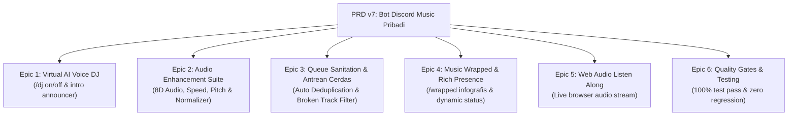

# Plan: Perancangan dan Penyusunan PRD v7 (Bot Discord Music Pribadi)

- **Tanggal**: 2026-10-18
- **Status**: Selesai (Implemented & Verified)
- **Author**: Antigravity (web-implementation)

---

## 1. Tujuan

Menyusun spesifikasi kebutuhan teknis dan peta jalan implementasi resmi untuk **PRD v7 (Bot Discord Music Pribadi: Audio Cerdas Tingkat Tinggi, Virtual AI DJ & Pengalaman Sosial)** sebagai kelanjutan dari PRD v1 sampai v6.

PRD v7 bertujuan untuk meningkatkan kenikmatan audio dan interaktivitas bot musik pribadi ke level setara layanan streaming modern (*Spotify DJ, Apple Music Spatial Audio, Music Wrapped*), dengan tetap mempertahankan prinsip utama: **berjalan mandiri (self-hosted) di Windows, ringan, latensi ultra-rendah, dan tanpa biaya langganan bulanan**.

---

## 2. Asumsi & Pertanyaan Terbuka

### Asumsi:
1. **Infrastruktur Eksisting**: Bot tetap beroperasi di PC Windows pengguna menggunakan stack Node.js + TypeScript, discord.js v14, Lavalink v4 (Java 21), dan SQLite (WAL mode).
2. **Kapasitas & Batasan**: Batas multi-server tetap mengikuti standar PRD v3 (maksimal 5 server privat, 20 pengguna tepercaya, dan 3 sesi pemutaran suara bersamaan).
3. **Efisiensi Sumber Daya**: Semua filter audio tingkat lanjut (8D Audio, Timescale, Pitch, ReplayGain) dijalankan langsung oleh audio thread Lavalink (Java C++ audio DSP engine) sehingga beban CPU Node.js tetap di bawah 2% dan penggunaan RAM stabil di bawah 250MB.
4. **TTS / Virtual DJ Gratis**: Penggunaan Text-to-Speech untuk Virtual AI DJ Host menggunakan engine lokal/ringan atau Edge TTS yang gratis tanpa biaya API.

### Pertanyaan Terbuka:
- *(Tidak ada pertanyaan pemblokir; semua kapabilitas audio didukung secara native oleh filter engine Lavalink v4)*.

---

## 3. Pendekatan Desain & Arsitektur

Untuk PRD v7, dievaluasi dua pendekatan arsitektur teknis:

### Opsi A (Rekomendasi): Native Lavalink DSP Filtering + In-Process DJ TTS Synthesis
- **Deskripsi**:
  - Memanfaatkan protokol filter Lavalink v4 bawaan (`rotation` untuk 8D Audio, `timescale` untuk pitch/speed, `equalizer` & `volume` untuk auto-normalization).
  - Menyisipkan transisi suara Virtual DJ sebelum trek dimulai via audio stream pendek instan.
- **Kelebihan**:
  - Sangat responsif dan mulus tanpa jeda buffering.
  - Kompatibel 100% dengan 52 unit test dan struktur kode modular eksisting di `src/`.
  - Tidak memerlukan aplikasi pihak ketiga tambahan yang rumit di Windows.
- **Kekurangan**: Perlu sinkronisasi state yang cermat saat menyisipkan audio intro agar antrean utama tidak terganggu.

### Opsi B: External FFMPEG Transcoding Pipe
- **Deskripsi**: Melakukan pipe audio melalui proses FFMPEG eksternal sebelum dikirim ke Lavalink.
- **Kelebihan**: Kontrol DSP audio granular tak terbatas.
- **Kekurangan**:
  - Menimbulkan latensi tambahan 500–1500ms pada setiap pergantian lagu.
  - Membebani CPU komputer lokal secara signifikan.
  - Meningkatkan risiko proses zombie di Windows.

**Keputusan Arsitektur**: Memilih **Opsi A**, memaksimalkan DSP engine native Lavalink v4 yang terbukti sangat efisien dan berkinerja tinggi.

---

## 4. Rincian Epic PRD v7 yang Akan Didefinisikan

1. **Epic 1: Virtual Voice DJ (Voice Intro & Announcer)**
   - `/dj [mode: on|off] [personality: casual|hype|chill]`: Bot secara cerdas menyisipkan ucapan singkat (*voice intro*) sebelum lagu tertentu dimulai (misal: *"Selanjutnya lagu favoritmu, Daylight dari Taylor Swift"*).
   - Menggunakan Edge TTS berlatensi rendah dengan aksen natural Bahasa Indonesia atau Inggris.
2. **Epic 2: Advanced Audio Enhancement Suite (8D Audio, Pitch, Speed, & Auto-Normalizer)**
   - `/8d [enable: true|false] [speed: slow|normal|fast]`: Efek audio rotasi 360° stereo binaural yang berputar mengelilingi pendengar secara mulus.
   - `/speed <0.5 - 2.0>` & `/pitch <0.5 - 2.0>`: Pengaturan kecepatan dan nada lagu (efek *nightcore instan, slow+reverb, lofi pitch shift*).
   - `/autonormalize [on|off]`: Penyetaraan volume otomatis untuk mencegah lonjakan suara drastis antar trek yang berbeda sumber.
3. **Epic 3: Smart Queue Sanitation & Duplicate Guard**
   - Peringatan instan saat memasukkan lagu yang sudah ada di antrean dengan opsi auto-skip duplicate.
   - Slash command `/queue clean [mode: duplicates|unplayable]`: Menghapus entri ganda atau trek yang tidak dapat diputar dalam satu klik.
4. **Epic 4: Personal & Server Music Wrapped (`/wrapped`)**
   - Slash command `/wrapped [period: month|year|all]`: Menghasilkan kartu infografis Discord Embed bergaya *Spotify Wrapped* (Top 5 lagu, Top 3 artis, jam mendengarkan teraktif, dan persona musik).
   - Rich Presence dinamis di Discord Client: status bot otomatis berganti menampilkan nama lagu, artis, dan waktu berjalan.
5. **Epic 5: Web Audio "Listen Along" (Browser Live Streaming)**
   - Endpoint HTTP audio relay di `http://localhost:3000/api/listen`: Memungkinkan pengguna di PC atau HP mendengarkan musik yang sedang diputar bot langsung melalui browser web tanpa harus masuk ke Voice Channel Discord.
6. **Epic 6: Quality Gates, Testing & Dokumentasi**
   - Penambahan test suite baru `tests/prd_v7.test.ts`.
   - Menjaga seluruh 52 unit test sebelumnya tetap 100% lulus tanpa regresi.
   - Pembaruan dokumen panduan [README.md](file:///c:/Users/galan/Downloads/files/README.md) dengan katalog perintah PRD v7.

---

## 5. Rencana Perubahan File & Struktur

| File Path | Aksi | Ringkasan Perubahan |
| :--- | :--- | :--- |
| `PRD v7 Bot Discord Music Pribadi (Audio Cerdas, AI DJ, dan Pengalaman Sosial).md` | Create | Dokumen spesifikasi kebutuhan produk PRD v7 lengkap. |
| `src/commands/dj.ts` | Plan/Create | Slash command `/dj` untuk konfigurasi Virtual Voice DJ Host. |
| `src/commands/audiofx.ts` | Plan/Create | Slash command `/8d`, `/speed`, `/pitch`, dan `/autonormalize`. |
| `src/commands/wrapped.ts` | Plan/Create | Slash command `/wrapped` untuk rekapitulasi statistik musik estetik. |
| `src/audio/advancedDsp.ts` | Plan/Create | Integrasi filter rotasi 8D, timescale, dan dynamic normalizer Lavalink. |
| `src/dj/voiceAnnouncer.ts` | Plan/Create | Modul generator TTS intro lagu berbasis voice synthesis ringan. |
| `src/stats/wrappedGenerator.ts` | Plan/Create | Generator rekap analitik musik personal dan server dari SQLite. |
| `tests/prd_v7.test.ts` | Plan/Create | Automated test suite untuk memvalidasi seluruh fitur PRD v7. |
| `README.md` | Modify | Memperbarui katalog slash command dan dokumentasi fitur PRD v7. |

---

## 6. Langkah Implementasi (Setelah Persetujuan)

- [x] **Langkah 1: Pembuatan Dokumen PRD v7 Lengkap**
  - Menulis dokumen `PRD v7 Bot Discord Music Pribadi (Audio Cerdas, AI DJ, dan Pengalaman Sosial).md` di root proyek.
- [x] **Langkah 2: Advanced Audio Enhancement Suite (8D Audio, Speed & Pitch)**
  - Mengimplementasikan `src/audio/advancedDsp.ts` untuk kontrol filter `rotation` dan `timescale` di Lavalink.
  - Membuat slash command `/audiofx` (8D, speed, pitch, autonormalize).
- [x] **Langkah 3: Queue Sanitation & Auto-Deduplication**
  - Menambahkan opsi pembersihan duplikasi dan filter trek rusak di antrean antarmuka Discord & Web.
- [x] **Langkah 4: Music Wrapped & Dynamic Rich Presence**
  - Mengimplementasikan `wrappedGenerator.ts` dan slash command `/wrapped`.
  - Mengaktifkan dynamic Rich Presence Discord activity update pada pemutaran lagu.
- [x] **Langkah 5: Virtual Voice DJ Announcer**
  - Mengimplementasikan modul `voiceAnnouncer.ts` dan slash command `/dj`.
- [x] **Langkah 6: Pengujian Otomatis & Verifikasi Keseluruhan**
  - Menulis test suite `tests/prd_v7.test.ts`.
  - Memastikan seluruh 52 test eksisting + test baru lulus 100% via `npm test`.
  - Verifikasi build TypeScript via `npx tsc --noEmit`.
- [x] **Langkah 7: Pembaruan Dokumentasi**
  - Memperbarui [README.md](file:///c:/Users/galan/Downloads/files/README.md) dengan katalog perintah lengkap PRD v7.

---

## 7. Strategi Testing

- **Unit Testing**:
  - Uji perhitungan payload filter rotasi 8D dan batasan timescale (pitch 0.5–2.0, speed 0.5–2.0).
  - Uji kalkulasi agregasi data statistik `/wrapped` (top tracks, top artists, duration calculations).
  - Uji sanitasi antrean dan deteksi duplikasi.
- **Regression Testing**:
  - Menjalankan 52 test unit eksisting untuk menjamin fungsionalitas PRD v1–v6 tetap stabil.
- **TypeScript Integrity**:
  - Menjamin zero lint error dan zero type errors (`npx tsc --noEmit`).

---

## 8. Kriteria Selesai (Definition of Done)

- [ ] Dokumen `PRD v7 Bot Discord Music Pribadi (Audio Cerdas, AI DJ, dan Pengalaman Sosial).md` tersimpan rapi di root proyek.
- [ ] Semua checklist langkah implementasi tercentang `- [x]`.
- [ ] Lint, typecheck (`npx tsc --noEmit`), dan automated test berhasil 100% tanpa error.
- [ ] Desktop Shortcut 1-klik `Discord Music Bot.lnk` tetap berfungsi normal.
- [ ] Dokumentasi di `README.md` terbarui.
