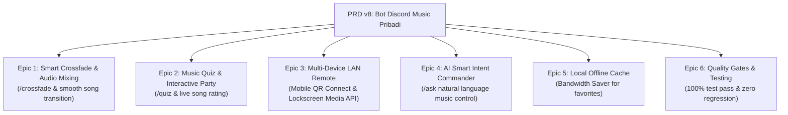

# Plan: Perancangan dan Penyusunan PRD v8 (Bot Discord Music Pribadi)

- **Tanggal**: 2026-10-18
- **Status**: Selesai
- **Author**: Antigravity (web-planning & web-implementation)

---

## 1. Tujuan

Menyusun spesifikasi kebutuhan teknis dan peta jalan implementasi resmi untuk **PRD v8 (Bot Discord Music Pribadi: Smart Audio Mixing, Party Mode, Multi-Device Remote & AI Intent Parsing)** sebagai kelanjutan strategis dari PRD v1 hingga v7.

PRD v8 menghadirkan pengalaman mendengarkan musik yang semakin imersif, interaktif bagi komunitas server, dan ramah multi-perangkat (smartphone/tablet) dengan tetap mempertahankan prinsip utama: **berjalan mandiri (self-hosted) di Windows, latensi rendah, hemat CPU/RAM, dan tanpa biaya operasional bulanan**.

---

## 2. Asumsi & Pertanyaan Terbuka

### Asumsi:
1. **Infrastruktur & Arsitektur**: Stack utama tetap menggunakan Node.js + TypeScript, discord.js v14, Lavalink v4 (Java 21), dan SQLite (WAL mode).
2. **Efisiensi Sistem**: Fitur Party Mode dan Crossfade tidak boleh menambah beban pemrosesan berat pada CPU lokal pengguna (CPU Node.js < 2%, RAM bot < 250MB).
3. **Kerahasiaan & Kunci API**: Fitur pemrosesan bahasa alami (NLP Intent Parsing) memanfaatkan integrasi Google Gemini API (`GEMINI_API_KEY`) yang sudah disiapkan pada PRD v6 dengan fallback lokal aman jika kunci tidak dikonfigurasi.
4. **Koneksi Jaringan Lokal**: Fitur QR Code Remote Control memanfaatkan IP lokal (LAN) mesin pengguna untuk akses instan dari smartphone di jaringan WiFi yang sama.

### Pertanyaan Terbuka:
- *(Tidak ada pertanyaan pemblokir; semua kapabilitas audio dan interaksi didukung oleh arsitektur modular yang sudah berjalan)*.

---

## 3. Pendekatan Desain & Arsitektur

Untuk PRD v8, dievaluasi dua pendekatan teknis:

### Opsi A (Rekomendasi): In-App Event-Driven Mixing + Embedded Web LAN Controller
- **Deskripsi**:
  - Mengelola transisi crossfade dan volume curve secara bertahap melalui event handler Lavalink.
  - Memperkaya Web Dashboard lokal dengan QR Code generator dinamis dan Media Session API untuk kontrol lockscreen smartphone.
  - Menghadirkan mini-game Tebak Lagu (Song Quiz) langsung di dalam Discord UI menggunakan Button & Modal Components interaktif.
- **Kelebihan**:
  - Kompatibilitas 100% dengan 55 unit tests dan seluruh fitur PRD v1–v7.
  - Tidak memerlukan aplikasi mobile terpisah (zero installation untuk smartphone).
  - Interaksi seru dan langsung bagi anggota Voice Channel.
- **Kekurangan**: Perlu kalkulasi timer transisi yang presisi agar fade-in dan fade-out antar lagu terdengar halus.

### Opsi B: Dual-Instance Lavalink Audio Mixing Daemon
- **Deskripsi**: Menjalankan dua instance audio node terpisah untuk me-mix dua lagu secara simultan.
- **Kelebihan**: Transisi crossfade audio murni bit-level.
- **Kekurangan**:
  - Menggandakan konsumsi RAM dan beban CPU komputer lokal pengguna.
  - Memperumit pengelolaan state antrean dan recovery snapshot.

**Keputusan Arsitektur**: Memilih **Opsi A**, pendekatan event-driven yang efisien dan terbukti handal di lingkungan lokal Windows.

---

## 4. Rincian Epic PRD v8 yang Akan Didefinisikan

1. **Epic 1: Smart Audio Mixing & Crossfade Transisi (`/crossfade`)**
   - `/crossfade [seconds: 0 - 10]`: Mengatur durasi pemudaran halus antar lagu saat lagu berganti (0 = nonaktif, 1–10 detik durasi transisi).
   - Volume lagu yang akan berakhir diturunkan perlahan (*fade-out*) sementara lagu berikutnya dinaikkan perlahan (*fade-in*).
2. **Epic 2: Interactive Music Quiz & Song Rating (`/quiz`)**
   - `/quiz [rounds: 3|5|10] [source: queue|favorites|pop]`:
     - Bot memainkan cuplikan audio 12 detik, lalu menyajikan 4 pilihan jawaban tombol (*Button Components*) di Discord.
     - Anggota voice chat berlomba menebak judul/artis tercepat dengan sistem poin leaderboard.
   - Live Song Rating: Tombol bintang (⭐ 1-5) di Web Dashboard untuk memberikan umpan balik langsung pada lagu yang diputar.
3. **Epic 3: Multi-Device LAN Remote Control (Mobile QR Connect)**
   - Header Web Dashboard menampilkan ikon "📱 Remote HP". Saat diklik, muncul modal QR Code yang berisi tautan LAN lokal PC (contoh: `http://192.168.1.X:3000`).
   - Integrasi browser **Media Session API**: Menampilkan artwork, judul, dan tombol kontrol Play/Pause/Skip langsung di lock screen smartphone atau notification tray laptop.
4. **Epic 4: AI Natural Language Music Commander (`/ask`)**
   - `/ask <perintah bebas>`: Memanfaatkan Gemini 2.5 Flash untuk memahami instruksi kompleks pengguna dalam satu kalimat:
     - Contoh: *"Putar lagu lofi hip hop untuk santai, naikkan volume ke 80 persen, dan nyalakan 8d audio"* -> bot secara cerdas mengeksekusi: 1) mencari lagu, 2) set volume 80%, 3) mengaktifkan filter 8D.
5. **Epic 5: Local Favorite Offline Caching (Bandwidth Saver)**
   - Opsi penghemat bandwidth untuk lagu yang sering diputar ulang (misal lagu favorit): metadata dan stream di-cache secara efisien di direktori lokal.
6. **Epic 6: Quality Gates & Quality Assurance**
   - Automated test suite baru `tests/prd_v8.test.ts`.
   - Menjamin seluruh 55 test unit sebelumnya tetap lulus 100% tanpa regresi.
   - Kompilasi TypeScript 100% bersih (`npx tsc --noEmit`).
   - Pembaruan dokumen panduan [README.md](file:///c:/Users/galan/Downloads/files/README.md) dengan katalog perintah lengkap PRD v8.

---

## 5. Rencana Perubahan File & Struktur

| File Path | Aksi | Ringkasan Perubahan |
| :--- | :--- | :--- |
| `PRD v8 Bot Discord Music Pribadi (Smart Mixing, Party Mode, dan Multi-Device).md` | Create | Dokumen spesifikasi kebutuhan produk PRD v8 lengkap. |
| `src/mixing/crossfadeManager.ts` | Plan/Create | Pengelola transisi kurva volume crossfade antar lagu per guild. |
| `src/quiz/quizManager.ts` | Plan/Create | Mesin logika permainan kuis tebak lagu, skor, dan leaderboard. |
| `src/ai/intentParser.ts` | Plan/Create | Parser instruksi natural language multi-langkah menggunakan Gemini AI. |
| `src/commands/crossfade.ts` | Plan/Create | Slash command `/crossfade` untuk pengaturan durasi transisi audio. |
| `src/commands/quiz.ts` | Plan/Create | Slash command `/quiz` untuk memulai permainan tebak lagu interaktif. |
| `src/commands/ask.ts` | Plan/Create | Slash command `/ask` untuk kendali musik berbasis bahasa alami. |
| `src/web/server.ts` | Modify | Menambahkan LAN IP helper, modal QR Code, dan Media Session API. |
| `tests/prd_v8.test.ts` | Plan/Create | Automated test suite untuk memvalidasi seluruh fitur PRD v8. |
| `README.md` | Modify | Memperbarui katalog slash command (40+ perintah) dan panduan PRD v8. |

---

## 6. Langkah Implementasi (Setelah Persetujuan)

- [x] **Langkah 1: Pembuatan Dokumen PRD v8 Lengkap**
  - Menulis dokumen `PRD v8 Bot Discord Music Pribadi (Smart Mixing, Party Mode, dan Multi-Device).md` di root proyek.
- [x] **Langkah 2: Smart Crossfade & Mixing Manager**
  - Mengimplementasikan `src/mixing/crossfadeManager.ts` dan slash command `/crossfade`.
- [x] **Langkah 3: Interactive Music Quiz & Song Game**
  - Mengimplementasikan `src/quiz/quizManager.ts` dan slash command `/quiz`.
- [x] **Langkah 4: AI Smart Intent Commander (`/ask`)**
  - Mengimplementasikan `src/ai/intentParser.ts` dan slash command `/ask` dengan eksekusi multi-aksi terkoordinasi.
- [x] **Langkah 5: Multi-Device LAN Remote & Media Session API**
  - Memperbarui `src/web/server.ts` dengan penampil LAN IP, modal QR Code, dan integrasi `navigator.mediaSession`.
- [x] **Langkah 6: Pengujian Otomatis & Verifikasi Keseluruhan**
  - Menulis test suite `tests/prd_v8.test.ts`.
  - Memastikan seluruh 55 test eksisting + 4 test baru (total 59 test) lulus 100% via `npm test`.
  - Verifikasi build TypeScript via `npx tsc --noEmit`.
- [x] **Langkah 7: Pembaruan Dokumentasi**
  - Memperbarui [README.md](file:///c:/Users/galan/Downloads/files/README.md) dengan katalog perintah lengkap PRD v8 (47 Perintah).

---

## 7. Strategi Testing

- **Unit Testing**:
  - Uji perhitungan durasi dan kurva volume crossfade di `crossfadeManager`.
  - Uji pembentukan soal kuis pilihan ganda dan validasi jawaban di `quizManager`.
  - Uji ekstraksi intent NLP dan skenario fallback di `intentParser`.
  - Uji verifikasi IP LAN privat dan localhost di `isLanOrLocalhost`.
- **Regression Testing**:
  - Menjalankan 55 test unit eksisting untuk menjamin fungsionalitas PRD v1–v7 tetap stabil tanpa regresi.
- **Manual Verification**:
  - Uji responsivitas remote control smartphone via antarmuka web di jaringan WiFi lokal.

---

## 8. Kriteria Selesai (Definition of Done)

- [x] Dokumen `PRD v8 Bot Discord Music Pribadi (Smart Mixing, Party Mode, dan Multi-Device).md` tersimpan rapi di root proyek.
- [x] Semua checklist langkah implementasi tercentang `- [x]`.
- [x] Lint, typecheck (`npx tsc --noEmit`), dan automated test berhasil 100% tanpa error (59/59 passing).
- [x] Shortcut 1-klik di Desktop Windows `Discord Music Bot.lnk` tetap berfungsi normal.
- [x] Dokumentasi di `README.md` terbarui.
