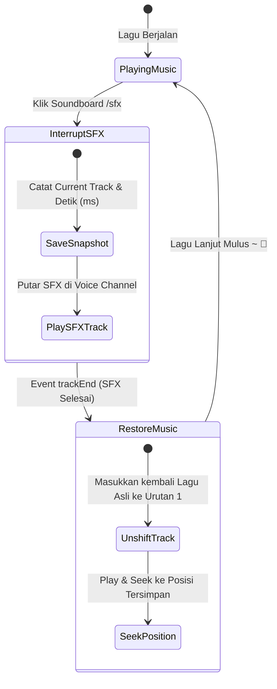
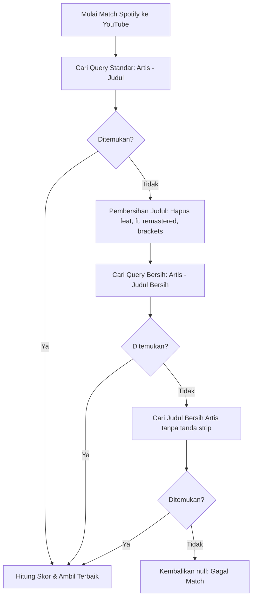

# Plan: Smart Resume SFX & Smart Clean Search (Auto-Skip First Track)

- **Tanggal**: 2026-10-19
- **Status**: Draft (Menunggu Persetujuan)
- **Author**: Antigravity (web-planning)
- **Target Subsystem**: Discord Audio Player (`Lavalink`), Soundboard Web (`/api/player/sfx`), Slash Command (`/sfx`), dan Spotify Resolver/Matcher (`matcher.ts`, `play.ts`).

---

## 1. Tujuan

1. **Smart Resume SFX**:
   Mengubah perilaku tombol Quick Soundboard di Web Dashboard dan Slash Command `/sfx` di Discord agar **tidak lagi men-skip/membuang lagu yang sedang diputar**. Saat SFX berbunyi:
   - Lagu aktif dijeda dan disimpan posisinya (misal menit `01:45`).
   - Efek suara SFX diputar selama durasinya (2–3 detik).
   - Setelah SFX selesai, bot otomatis melanjutkan kembali lagu tersebut persis dari posisi `01:45`.
   - Tidak memunculkan pesan "Now Playing" berulang untuk klip SFX agar ruang obrolan tetap bersih.

2. **Smart Clean Search & Auto-Skip First Track**:
   Mencegah kegagalan total pemuatan playlist/album Spotify seperti kasus `Indecision (feat. Daniel Caesar)`:
   - **Smart Clean Search**: Membersihkan metadata bising seperti `(feat. ...)`, `[Remastered]`, `(Official Video)` saat pencarian awal YouTube gagal, lalu mencoba pencarian fallback.
   - **Auto-Skip First Track**: Jika lagu nomor 1 pada playlist Spotify tidak ditemukan di YouTube, bot otomatis mencari lagu nomor 2 (atau berikutnya) sebagai lagu pembuka tanpa membatalkan seluruh playlist.

---

## 2. Asumsi & Pertanyaan Terbuka

### Asumsi
- Satu guild hanya memicu satu efek suara SFX dalam satu waktu (interupsi berurutan, bukan spam paralel simultan).
- Durasi SFX relatif singkat (< 15 detik), sehingga menyimpan posisi lagu di memori proses bot aman dan instan.
- Jika pengguna sengaja menekan tombol "Skip" atau "Stop" saat SFX sedang berbunyi, sesi Smart Resume otomatis dibatalkan secara elegan.

---

## 3. Pendekatan Desain & Arsitektur

### Fitur 1: Smart Resume SFX Interruption State Machine



- **Mekanisme**:
  - Dibuat state manager `sfxInterruptions = new Map<string, SfxInterruptionState>()` di `src/player/sfxManager.ts`.
  - Saat `/api/player/sfx` atau `/sfx` dipicu:
    - Jika `player.playing && player.queue.current`:
      1. Catat `originalTrack = player.queue.current`, `pos = player.position`.
      2. Set metadata pada track SFX `(sfxTrack as any).isSfx = true`.
      3. Simpan state interupsi untuk guild tersebut.
      4. Masukkan track SFX dan jalankan `player.play({ track: sfxTrack })` atau unshift + skip.
    - Jika tidak ada lagu yang diputar: Putar track SFX normal tanpa restore.
  - Pada event `lavalink.on("trackEnd")`:
    - Cek apakah guild memiliki `sfxInterruptions`.
    - Jika track yang baru selesai adalah SFX:
      1. Ambil data lagu asli dan posisi seek.
      2. Putar kembali lagu asli pada posisi millisecond yang dicatat.
      3. Hapus state interupsi guild tersebut.
      4. Jangan kirim embed "Now Playing" baru agar obrolan Discord tidak spam.

---

### Fitur 2: Smart Clean Search & Progressive Fallback



- **Mekanisme `cleanTitleForSearch`**:
  - Regex yang menghapus noise:
    - `/\s*[\(\[](?:feat|ft)\.?\s+[^\)\]]+[\)\]]/gi`
    - `/\s*[\(\[](?:official\s+(?:video|audio|music\s+video)|lyric\s+video)[\)\]]/gi`
    - `/\s*[\(\[](?:remastered|deluxe|expanded|anniversary)[\)\]]/gi`
  - Contoh: `"Indecision (feat. Daniel Caesar)"` -> `"Indecision"`
  - Pencarian YouTube otomatis jauh lebih akurat dan tidak akan terblokir oleh metadata ekstra Spotify.

---

### Fitur 3: Auto-Skip First Track pada Playlist Spotify

- **Mekanisme di `src/commands/play.ts`**:
  - Alih-alih hanya memeriksa `result.tracks[0]`:
    ```typescript
    let firstTrack: Track | UnresolvedTrack | null = null;
    let initialItemIndex = -1;

    // Scan hingga 5 lagu pertama untuk menemukan track valid pembuka
    for (let i = 0; i < Math.min(result.tracks.length, 5); i++) {
      const candidate = await resolveSpotifyTrackWithCache(player, result.tracks[i], interaction.user);
      if (candidate) {
        firstTrack = candidate;
        initialItemIndex = i;
        break;
      }
    }
    ```
  - Jika lagu 1 gagal tapi lagu 2 berhasil:
    - Bot langsung memutar lagu 2.
    - Sisa lagu dari playlist tetap dimuat di background (progressive resolution).
    - Playlist tidak pernah gagal total!

---

## 4. Perubahan File

| File Path | Aksi | Ringkasan Perubahan |
| :--- | :--- | :--- |
| `src/player/sfxManager.ts` | Create | State manager untuk mencatat lagu & posisi yang diinterupsi oleh SFX, serta fungsi pembantu `playSfxWithSmartResume` |
| `src/player/lavalink.ts` | Modify | Hook pada `trackStart` (abaikan Now Playing untuk SFX) dan `trackEnd` (otomatis restore lagu asli dan seek ke posisi tersimpan) |
| `src/commands/sfx.ts` | Modify | Memanggil `playSfxWithSmartResume` alih-alih `unshift + skip` mentah |
| `src/web/server.ts` | Modify | Memanggil `playSfxWithSmartResume` pada handler endpoint `POST /api/player/sfx` |
| `src/matching/matcher.ts` | Modify | Menambahkan utilitas `cleanTitleForSearch` dan strategi pencarian bertingkat (fallback search) pada `matchSpotifyToYouTube` |
| `src/commands/play.ts` | Modify | Menerapkan loop scanning pencarian lagu pembuka playlist (`Auto-Skip First Track`) agar playlist tidak gagal total jika lagu awal tidak ada di YouTube |

---

## 5. Langkah Implementasi

- [ ] **Langkah 1**: Buat modul `src/player/sfxManager.ts` yang menyimpan state interupsi SFX per guild dan menyediakan fungsi `playSfxWithSmartResume`.
- [ ] **Langkah 2**: Integrasikan hook `trackStart` dan `trackEnd` di `src/player/lavalink.ts` agar saat track SFX selesai, lagu sebelumnya langsung diputar kembali dan di-seek ke posisi terakhir.
- [ ] **Langkah 3**: Perbarui `src/commands/sfx.ts` dan endpoint `POST /api/player/sfx` di `src/web/server.ts` agar menggunakan `playSfxWithSmartResume`.
- [ ] **Langkah 4**: Tambahkan fungsi `cleanTitleForSearch` di `src/matching/matcher.ts` dan integrasikan ke dalam tahapan pencarian fallback YouTube Music & YouTube.
- [ ] **Langkah 5**: Perbarui logika pemuatan playlist multi-track di `src/commands/play.ts` dengan scanning pencarian lagu pembuka (Auto-Skip First Track).
- [ ] **Langkah 6**: Jalankan build `npm run build` dan `npm test` untuk memastikan 100% tes (99/99) lulus.
- [ ] **Langkah 7**: Commit & push perubahan ke branch `main` GitHub.

---

## 6. Kriteria Selesai (Definition of Done)

- [ ] Saat lagu sedang diputar dan tombol soundboard diklik di web dashboard / `/sfx` di Discord: lagu terjeda, SFX berbunyi, lalu lagu kembali berlanjut dari detik terakhir.
- [ ] Jika lagu pertama di playlist Spotify tidak ditemukan di YouTube (seperti kasus `Indecision (feat. Daniel Caesar)`), bot tidak membatalkan playlist dan otomatis memulai dari lagu berikutnya yang tersedia.
- [ ] Judul lagu dengan format `(feat. ...)` otomatis dibersihkan saat pencarian awal YouTube tidak menemukan hasil.
- [ ] Semua unit test (100% pass) dan `npm run build` lulus tanpa error.
